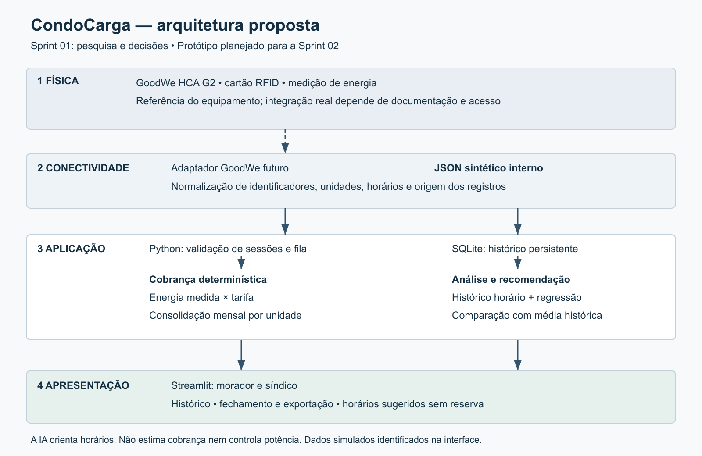

# CondoCarga

Pesquisa e proposta de gestão de recargas compartilhadas em condomínios

**Autor:** Édion Alberto Torres · **RM:** 570560  
**Curso:** Ciência da Computação on-line, FIAP  
**Challenge:** GoodWe 2026, trilha EV ChargeOps  
**Etapa:** Sprint 01 — pesquisa e documentação  
**Data da pesquisa:** 24 e 25 de setembro de 2026

O CondoCarga propõe relacionar cada sessão de recarga ao apartamento responsável, calcular seu consumo e produzir um fechamento mensal conferível. A inteligência artificial apoiará a escolha de horários de menor demanda. Nesta sprint, apresento a pesquisa e as decisões que orientarão um protótipo na Sprint 02. O protótipo local da Sprint 2 já cobre cadastros demonstrativos, sessões, fila, fechamento mensal e sugestões horárias. A regressão é avaliada contra uma referência simples; neste conjunto sintético a referência pode ser selecionada se tiver menor erro. Não há integração GoodWe validada nem resultados com dados reais.

## 1. Problema e recorte

Um carregador compartilhado reúne usuários com necessidades diferentes em uma infraestrutura limitada. A gestão precisa saber quem utilizou o equipamento, quanto consumiu e como distribuir os valores. O morador precisa compreender sua cobrança e organizar o uso. Ter energia medida no carregador não basta: é necessário vincular a medição a uma sessão e a uma unidade.

O desafio FIAP/GoodWe propõe transformar esses registros em gestão e inteligência operacional [1]. A documentação de soluções comerciais já oferece cobrança individual e relatórios, confirmando que o problema possui respostas no mercado [2–5]. Portanto, não apresento a proposta como uma invenção inédita. O objetivo acadêmico é projetar um fluxo explicável, adequado ao ecossistema do desafio e aos conhecimentos estudados.

Delimito a primeira versão a um condomínio, usuários fictícios, identificação RFID simulada e fechamento por unidade. Os públicos são o morador e o síndico. Pagamentos bancários, instalação elétrica, aplicativo nativo, autenticação de produção e comando remoto de potência ficam fora do primeiro protótipo. As mesmas questões podem ocorrer em edifícios corporativos e campi, mas esses ambientes não serão implementados nesta versão.

Os desafios operacionais considerados são identificação, disputa pelo uso, registros incompletos, conciliação dos valores e dependência de dados confiáveis. Não realizei entrevistas com moradores: essas necessidades resultam do enunciado e da pesquisa documental, devendo ser validadas em campo antes de uma implantação.

## 2. Frente 1 — Contexto e análise de mercado

**Aprofundamento escolhido: opção C, análise de dados públicos.** A comparação de três soluções, correspondente à opção A, permanece como pesquisa complementar.

### O que é infraestrutura de recarga compartilhada

É o conjunto de pontos de recarga, circuitos e proteções elétricas, medição, conectividade e regras de gestão que atende vários usuários. O compartilhamento pode ocorrer nas vagas, nos carregadores ou na capacidade elétrica disponível. Em condomínios, é necessário associar o uso ao apartamento. Em empresas e campi, a gestão pode distinguir funcionários, visitantes e veículos institucionais. Controle de acesso, disponibilidade, manutenção, filas e conferência dos custos são problemas comuns [2, 24–25].

O risco operacional inclui veículos que permanecem na vaga após o fim da recarga, uso simultâneo acima da capacidade projetada e registros que não chegam ao sistema. Minha decisão é priorizar identificação, sessões e conferência do consumo no protótipo. A gestão elétrica e a segurança física continuam sob responsabilidade de equipamentos e profissionais habilitados. O software proposto não substitui essas proteções.

### Como uma sessão gera dados

O equipamento verifica condições de conexão e segurança antes de permitir o fornecimento. O modelo lógico adotado tem cinco momentos: conexão do veículo, identificação/autorização, início da transferência, acompanhamento e encerramento. Conectar o cabo não significa necessariamente que a energia já esteja sendo transferida. Na proposta, o registro terá estados próprios para distinguir sessão aberta de encerrada.

O HCA G2 oferece início por aplicativo, RFID ou modo automático, conforme a ficha técnica [6]. No kickoff, a GoodWe explicou o registro do cartão e da energia utilizada [1]. A plataforma proposta vinculará o identificador a usuário e unidade, preservando essa associação na sessão.

| Momento | Dado necessário ao CondoCarga | Transformação proposta |
|---|---|---|
| Identificação | Credencial, usuário e unidade | Resolver o vínculo autorizado |
| Início | Sessão, carregador, horário e leitura inicial | Fixar unidade e tarifa da sessão |
| Acompanhamento | Estado e medições por intervalo, se disponíveis | Histórico operacional e análise temporal |
| Encerramento | Horário e leitura final ou energia total documentada | Validar e normalizar consumo |
| Fechamento | Sessões válidas, unidade e tarifa | Somar consumo e valores por mês |

Ao encerrar por solicitação, conclusão ou interrupção, o sistema precisa registrar o motivo e a última medição confiável. O fim da transferência de energia não significa que a vaga foi desocupada. A ordem entre conexão e autorização pode variar conforme o equipamento.

O medidor produz a leitura de energia; o controlador registra estados, horários e falhas. A plataforma associa esses eventos à sessão e à unidade. Em equipamentos compatíveis, OCPP conecta carregador e sistema de gestão [26]; uma API autorizada do fabricante é outro caminho. Isso não comprova suporte ou acesso OCPP no HCA G2 adotado pelo desafio. O caminho de captura real depende de uma interface documentada do equipamento. A existência física dessas conexões não confirma quais dados terceiros podem consultar. Na Sprint 02, eventos sintéticos exercitarão o mesmo modelo interno, sem simular uma API oficial inexistente.

### Soluções pesquisadas

| Solução e mercado da fonte | Problema e funcionalidades documentadas | Modelo de negócio observado | Limites e consequência para a proposta |
|---|---|---|---|
| ChargePoint, página para condomínios | Gestão de vagas atribuídas e compartilhadas, controle de acesso, relatórios de energia e custos, cobrança e compartilhamento de potência [2] | Oferta integrada de equipamento, software e suporte; a propriedade configura políticas de cobrança | Exige avaliar contratação e implantação. A página não comprova compatibilidade com o HCA G2 nem oferta equivalente no Brasil. Aproveito a separação entre políticas de uso e cobrança |
| Wallbox Business Portal, oferta internacional | Gestão de carregadores, locais e usuários; estatísticas e pagamentos por sessão ou fechamento mensal [3] | Portal associado ao ecossistema de carregadores; opções de monetização. A documentação de cobrança mensal consultada descreve comissão por sessão [4] | Portal e processamento de pagamento não têm necessariamente o mesmo custo. Condições variam por serviço/mercado; não extrapolo valores ao Brasil. Aproveito a transparência do histórico por usuário |
| NeoCharge, oferta brasileira para condomínios | Operação por aplicativo, instalação e manutenção pelo fornecedor, reembolso mensal da energia ao condomínio [5] | Recarga como serviço, com cobrança do motorista e contrato de operação | A oferta depende de avaliação da infraestrutura e menciona contrato de 60 meses. É uma proposta comercial específica, não uma regra geral do setor. Aproveito a distinção entre gasto do condomínio e valor cobrado ao usuário |

**Análise:** as três soluções mostram que o desafio não se resume a construir uma tela. É preciso conectar identidade, medição, operação e prestação de contas. Para o CondoCarga, adoto esse fluxo completo, mas deixo a liquidação financeira fora do protótipo. O diferencial acadêmico será tornar os cálculos e as decisões de IA verificáveis, não alegar superioridade sobre plataformas comerciais.

### Modelos de cobrança e seus efeitos

As políticas documentadas pela ChargePoint incluem gratuidade, energia, tempo e taxas por sessão [7]. A cobrança mensal da Wallbox admite tarifa e/ou assinatura [4]. No Brasil, a oferta NeoCharge exemplifica operação com reembolso ao condomínio [5]. Esses casos mostram possibilidades comerciais; não demonstram frequência ou predominância de cada modelo.

| Modelo | Vantagem para gestão | Limitação no condomínio |
|---|---|---|
| Gratuito ao usuário | Pouca fricção de pagamento | O custo precisa ser absorvido por alguém; não distingue consumo individual |
| Por kWh | Relação direta com energia medida | Exige medição e vínculo confiáveis |
| Por tempo conectado | Pode incentivar liberação da vaga | Tempo conectado e energia recebida não são equivalentes |
| Assinatura mensal | Previsibilidade do valor | Uso desigual pode gerar subsídios cruzados |
| Rateio por consumo na cobrança condominial | Permite explicar o valor a partir das sessões | Requer política explícita para exceções e custos não medidos |

**Escolha:** rateio do componente variável por consumo medido. Duas unidades com uso diferente devem receber valores diferentes. Não escolho divisão igual entre apartamentos porque ela desconsidera a energia efetivamente utilizada. Também não escolho cobrança por tempo no MVP porque velocidades de recarga diferentes poderiam produzir custos diferentes para a mesma energia.

### Opção C — Análise de dados públicos

Analiso indicadores publicados por ABVE/Tupi, ABVE Data e VoltBras, com referência internacional do DOE/AFDC para contextos de uso [21–25]. São publicações abertas, não uma coleta própria de sessões nem uma extração de microdados. A pergunta é: o crescimento e a distribuição da recarga justificam um sistema de gestão por unidade, e quais dados locais ainda faltam?

#### Frota e crescimento do mercado brasileiro

BEV é o veículo elétrico a bateria; PHEV é o híbrido com recarga externa. Ambos utilizam tomada. HEV e micro-híbridos não devem ser somados para estimar demanda por carregadores.

| Indicador | Período | Resultado | Leitura e limite |
|---|---|---:|---|
| Frota plug-in informada pela ABVE/Tupi | Acumulado de 2022 a maio/2026 | 505.806 BEV + PHEV | Recorte declarado pela fonte, não censo integral da frota registrada [21] |
| Vendas mensais de plug-in | Agosto/2025 | 15.681 | 7.624 BEV + 8.057 PHEV [22] |
| Vendas mensais de plug-in | Agosto/2026 | 47.701 | 27.166 BEV + 20.535 PHEV [22] |
| Variação das vendas mensais | Agosto/2026 sobre agosto/2025 | +204,2% | Cálculo próprio: `(47.701 / 15.681 - 1) × 100` |

**Análise:** o estoque informado e a expansão das vendas sustentam a relevância do tema, mas o aumento de 204,2% é das vendas no mesmo mês de anos distintos. Não significa que a frota triplicou. Não estimei crescimento líquido da frota, pois isso exigiria uma série de estoques comparáveis e tratamento de baixas. Para dimensionar um condomínio, ainda é necessário levantar seus veículos, usuários e capacidade instalada.

#### Distribuição dos pontos de recarga

O levantamento ABVE/Tupi publicado em junho, com corte em maio/2026, informa 25.429 pontos públicos e semipúblicos, crescimento de 20,7% desde fevereiro. A composição é de 66% AC e 34% DC [21].

| Região | Pontos em maio/2026 | Participação aproximada no total publicado |
|---|---:|---:|
| Sudeste | 11.079 | 43,6% |
| Sul | 6.115 | 24,0% |
| Nordeste | 4.542 | 17,9% |
| Centro-Oeste | 2.840 | 11,2% |
| Norte | 859 | 3,4% |

Percentuais calculados sobre 25.429. A tabela original soma 25.435, seis pontos acima do total nacional publicado. Preservo os valores e explicito a divergência. Esse universo não inclui toda a recarga privada residencial nem equivale à disponibilidade em tempo real [21].

**Análise:** a concentração regional impede usar uma média nacional para prever a facilidade de recarga de um morador. Número de pontos também não informa sozinho potência disponível, filas ou funcionamento. Por isso, mapas externos serão apoio futuro, enquanto o núcleo do CondoCarga usará registros do próprio condomínio. O recorte de maio foi mantido para relacionar frota e rede na mesma publicação, sem alegação de ser a estatística mais recente.

#### Perfis de uso e qualidade da operação

| Contexto de uso | Referência técnica | Consequência para a pesquisa do CondoCarga |
|---|---|---|
| Residencial | Recarga durante permanência prolongada no local [24] | Investigar chegada, saída e preferências dos moradores |
| Empresa ou campus | Permanência associada à jornada e regras de acesso [25] | Não transportar automaticamente esses horários para um condomínio |
| Viagens e deslocamentos | Recarga pública em corredores e necessidade de compatibilizar parada e potência [24] | Diferenciar conveniência de localização de disponibilidade real |

Esses perfis são referências qualitativas do DOE/AFDC dos Estados Unidos, não percentuais de comportamento medidos no Brasil. O resumo público do Anuário VoltBras 2025 traz dados autodeclarados por 56 redes, com 1.249 carregadores em 25 estados e no DF. Relata fricções no início das sessões, conectividade e pagamento [23]. A amostra é de operadores e não representa estatisticamente moradores de condomínios.

**Análise:** não há, nas fontes consultadas, uma distribuição nacional representativa de horários e duração de sessões condominiais. Essa lacuna impede afirmar um horário de pico brasileiro ou prometer redução de filas. Na Sprint 02, o histórico sintético será identificado como simulação. Em uma implantação, será necessário medir horários, duração, energia, falhas e, se houver registro de saída, ocupação após a recarga. Somente então será possível avaliar recomendações por horário.

**Decisão decorrente da Opção C:** manter o escopo de um condomínio, assegurar a qualidade dos registros antes da previsão e comparar a IA com uma referência simples. Dados nacionais contextualizam a proposta; não substituem o histórico local necessário à recomendação.

## 3. Frente 2 — Ecossistema técnico e regulatório

**Aprofundamento escolhido: opção C, mapeamento de duas APIs complementares.** A pesquisa básica de regulação, HCA G2 e SEMS permanece incluída.

### RN ANEEL 1.000/2021

A página da ANEEL atualizada em abril de 2026 remete ao Capítulo V da RN 1.000/2021 e confirma a exploração comercial com preços negociados [8]. Consultei os artigos em reprodução da norma hospedada pela SEMA/RS, datada de janeiro de 2025 [9]. O texto consolidado direto retornou erro de acesso; essa cópia não permite certificar todas as alterações posteriores.

| Dispositivo | Síntese do texto consultado | Decisão para o projeto |
|---|---|---|
| Art. 550 | Comunicação prévia em caso de nova conexão, mudança de carga ou tensão | Registrar essa verificação na implantação; não generalizar para qualquer situação |
| Art. 552 | Equipamentos não exclusivos de uso privado devem admitir protocolos abertos para comunicação e supervisão/controle remoto | Confirmar enquadramento e compatibilidade antes de integração real |
| Art. 553 | Aplicam-se normas da distribuidora e de órgãos competentes | Software não comprova conformidade da instalação |
| Art. 554 | Admite recarga de veículos de terceiros e exploração comercial | Justifica estudar modelos de cobrança, sem impor uma tarifa |

Não interpreto o art. 552 como imposição nominal de OCPP, nem considero um condomínio automaticamente enquadrado sem análise. A proposta não é um projeto elétrico aprovado. Normas estaduais/municipais e de segurança precisam de verificação específica em uma implantação; o aprofundamento escolhido nesta frente é de APIs, não um laudo regulatório completo.

### Interfaces do HCA G2

A ficha técnica lista Bluetooth, Wi-Fi, duas interfaces RS-485, LAN e RFID como método de início [6]. A página do produto informa integração com SEMS+ para monitoramento e programação [10]. A tabela distingue a capacidade geral da interface da operação específica ainda dependente de documentação.

| Interface | Papel técnico | Utilização possível e limite |
|---|---|---|
| RFID | Identificação por cartão | Vincular credencial à unidade. Não é rede de telemetria nem cadastro de apartamento pronto |
| LAN | Conexão cabeada à rede local | Caminho de conectividade; não prova endpoint ou comando disponível |
| Wi-Fi | Conexão sem fio à rede | Alternativa de conectividade sujeita à cobertura e configuração |
| Bluetooth | Comunicação local de curta distância | Possível configuração/interação próxima, a confirmar no manual da versão |
| RS-485 | Interface serial diferencial | Possível comunicação entre equipamentos; protocolo, registradores e permissões precisam ser documentados |

Escolho separar o adaptador de dados das regras de negócio. Assim, a confirmação posterior da interface real não obriga alterar as fórmulas ou a consolidação por apartamento. A ficha técnica não comprova um contrato público de API.

### Resultado da pesquisa sobre API GoodWe e SEMS

Consultei a página de produto, o catálogo oficial de downloads e o endereço SEMS+ indicado no enunciado [10–12]. A documentação de produto confirma monitoramento, mas o portal não expôs um contrato de API legível na consulta. O catálogo lista manual; as tentativas de abertura do PDF falharam. Não encontrei nessas fontes um contrato público oficial verificável de endpoints de sessões HCA G2, autenticação, paginação e limites. Isso é uma limitação da pesquisa, não prova de inexistência da API.

| Informação desejada | Evidência disponível | Situação para desenvolvimento |
|---|---|---|
| Identificação RFID e energia de recarga | Explicação do kickoff [1] | Confirmar campos e acesso autorizados |
| Monitoramento e programação | Página oficial do produto [10] | Capacidade do produto confirmada; interface de terceiros não confirmada |
| Status, potência e timestamps | Necessidades do modelo propostas pelo enunciado | Esquema e frequência não verificados em API oficial |
| Eventos de início/fim e medições horárias | Necessários ao fluxo e à IA proposta | Dependência de documentação; usar simulação declarada na Sprint 02 |

Antes de integrar, preciso obter da GoodWe/FIAP o contrato autorizado, identificação do modelo/firmware, exemplo anonimizado de resposta, unidades, fuso, limites e política de acesso. Os nomes de campos do CondoCarga serão internos, nunca apresentados como campos oficiais SEMS.

### APIs complementares

| API | Dados e acesso documentados | Uso considerado | Limitação e decisão |
|---|---|---|---|
| Open Charge Map | Localizações de recarga e contribuições como comentários; acesso por chave. O provedor exige atribuição das fontes e licenças [13–14] | Apresentar alternativas próximas quando o morador preferir recarga externa | O FAQ informa que o status não é garantia de disponibilidade ao vivo [14]. A rota de documentação detalhada redirecionou para login. Fica como evolução, sem depender dela no fechamento |
| Google Places API (New) | `evChargeOptions`, quantidade/tipo de conectores, potência máxima, contagens disponíveis e horário da atualização quando fornecidos [15]. Place Details usa `GET https://places.googleapis.com/v1/places/PLACE_ID`, chave e máscara de campos [16]; uso requer faturamento habilitado [17] | Consultar opções e características de recarga externas | Campo ausente não significa zero; contagem de conectores não equivale necessariamente a carros simultâneos. Cobertura, atualização e custos exigem avaliação. Não reservar vagas nem prometer disponibilidade |

**Análise:** as APIs enriquecem localização, mas não resolvem identidade e rateio no condomínio. Implementá-las antes do núcleo aumentaria dependências sem melhorar a conferência da cobrança. Por isso, pesquiso ambas nesta sprint e postergo a integração. Nenhuma chamada autenticada foi executada; os resultados são de consulta à documentação.

## 4. Frente 3 — Arquitetura e modelo de rateio

**Aprofundamento escolhido: opção B, comparação de duas abordagens de IA**, detalhada na próxima seção.

### Arquitetura proposta



*Figura 1 — Arquitetura proposta. Elaboração para o CondoCarga. A integração física é futura; o protótipo utilizará dados sintéticos.*

| Camada | Responsabilidade | Decisão |
|---|---|---|
| Física | Carregador, cartão e medições | HCA G2 como referência do Challenge; sem comando real no MVP |
| Conectividade | Receber dados e normalizar origem, unidade e horário | Adaptador simulado primeiro; conexão GoodWe condicionada a documentação |
| Aplicação | Validar sessão, persistir, calcular rateio e analisar histórico | Python com módulos separados e SQLite local |
| Apresentação | Histórico do morador, relatório do síndico e recomendação | Streamlit para demonstrar as jornadas com menor esforço de interface |

O fluxo proposto é: identificar a credencial, resolver a unidade, abrir sessão, guardar tarifa, registrar leitura final, validar consumo, calcular valor e agregar no relatório mensal. O histórico alimenta a IA em outro caminho. A previsão orienta horários; nunca substitui energia medida para cobrança.

Escolho um único aplicativo modular porque o projeto é individual. Serviços distribuídos e infraestrutura de produção não são necessários para testar as regras. A seleção de perfil será demonstrativa, sem alegação de autenticação segura. Dados reais de moradores e cartões não integram esta pesquisa.

### Modelo de dados mínimo

| Entidade | Atributos principais | Relação |
|---|---|---|
| Unidade | ID, número | Possui usuários e sessões |
| Usuário/credencial | ID, unidade, credencial opaca fictícia, ativo | Identifica quem inicia uso |
| Carregador | ID, estado simulado | Possui sessões e fila |
| Sessão | ID, unidade no início, usuário, veículo fictício, carregador, horários, leituras, tarifa, estado | Unidade histórica preservada mesmo após mudança cadastral |
| Medição por intervalo | Sessão, início/fim do intervalo, energia em kWh, origem | Alimenta agregação horária; soma conciliada em cenários completos |
| Solicitação | ID, usuário, carregador, criação, estado | Fila cronológica, com ID como desempate |
| Fechamento | Unidade, mês, sessões e totais calculados | Relatório derivado, sem liquidação bancária |

### Fórmulas e política de rateio

Para cada sessão válida `s`:

```text
E_s = leitura_final_kWh - leitura_inicial_kWh
V_s = arredondar_centavos(E_s × tarifa_s)
F_unidade,mês = soma(V_s das sessões válidas da unidade encerradas no mês)
```

`E_s` é energia, em kWh. `tarifa_s` é o preço configurado por kWh, registrado no início da sessão. `V_s` é o valor da sessão, e `F` é o total variável da unidade. Usarei cálculo decimal e arredondamento de meio centavo para cima por sessão; os totais somarão centavos inteiros. A tarifa uniforme pode mudar para sessões futuras, sem reescrever o histórico.

O mês é o de encerramento em `America/Sao_Paulo`. Não divido sessões entre meses no MVP: a regra simplifica conciliação, mas pode deslocar todo o consumo de uma sessão para o mês seguinte. Essa limitação será visível no relatório.

Exemplo inteiramente fictício com tarifa de R$ 1,00/kWh:

| Unidade | Veículo/sessão | Leitura inicial | Leitura final | Energia | Valor |
|---|---|---:|---:|---:|---:|
| 101 | V1 / S1 | 100 kWh | 112 kWh | 12 kWh | R$ 12,00 |
| 101 | V2 / S2 | 112 kWh | 115 kWh | 3 kWh | R$ 3,00 |
| 202 | V3 / S3 | 115 kWh | 123 kWh | 8 kWh | R$ 8,00 |
| 303 | Sem sessão | — | — | 0 kWh | R$ 0,00 |
| Total | | | | 23 kWh | R$ 23,00 |

A unidade 101 recebe R$ 15,00, mesmo com dois veículos. O relatório conserva o detalhe de cada sessão. Esse exemplo não informa uma tarifa de mercado nem economia obtida.

### Exceções e limites

| Caso | Tratamento proposto |
|---|---|
| Sessão interrompida com leitura válida | Cobrar somente energia efetivamente registrada até a interrupção |
| Interrupção sem leitura final confiável | Deixar pendente; não estimar cobrança com IA |
| Unidade sem uso no mês | Valor variável zero, pois não há taxa fixa no modelo |
| Dois veículos da mesma unidade | Sessões distintas, total consolidado no apartamento |
| Evento reenviado | Identificador único impede duplicar consumo e valor |
| Leitura decrescente ou horário inválido | Recusar encerramento e manter sessão ativa para correção |
| Carregador livre com fila | Somente o primeiro pedido pode iniciar; cancelamento libera a ordem |

Não distribuo custos fixos nem perdas neste primeiro cálculo. Logo, o fechamento é do componente medido de recarga, não uma conciliação integral da conta elétrica do condomínio. Uma futura política poderá separar investimento, manutenção e diferença de medição, após decisão explícita de gestão. A tarifa configurada também não deve ser confundida automaticamente com o custo de aquisição de energia.

## 5. IA como apoio à gestão

A aplicação precisa transformar o histórico em uma orientação útil. Pesquisei regressão linear e Isolation Forest nas documentações dos métodos [18–19].

| Abordagem | Problema e técnica | Dados necessários | Impacto esperado e limites |
|---|---|---|---|
| Previsão por regressão | Estimar energia agregada em uma hora futura; ajustar relação entre características e consumo [18] | Energia horária, hora cíclica, dia da semana e histórico anterior | Ordenar faixas preferidas pelo morador por menor demanda prevista. Relações podem ser não lineares; não prevê disponibilidade física com certeza |
| Detecção de anomalias por Isolation Forest | Identificar sessões com combinações incomuns por isolamento em árvores aleatórias [19] | Duração, energia, potência média derivada e contexto de uso | Priorizar revisão do síndico. Uma sessão incomum pode ser legítima; alerta não comprova erro, fraude ou defeito |

**Escolha para a Sprint 02:** regressão como abordagem principal, por sua relação com os conteúdos de modelagem estudados e por apoiar a organização de uso. Detecção de anomalias fica como evolução pesquisada. Não utilizarei um chatbot genérico como substituto da análise de consumo.

O alvo será energia em kWh em intervalos regulares de uma hora. Para evitar inventar distribuição temporal, o conjunto sintético deverá conter medições por intervalo conciliáveis com as sessões. Se a integração real disponibilizar apenas totais, a previsão horária exigirá outra fonte de medição ou revisão do alvo.

O processo de avaliação utilizará treino anterior ao teste, conforme a orientação de validação temporal [20]. A referência será a média histórica por faixa calculada apenas no treino. Compararei o erro absoluto médio em kWh. Variáveis e estatísticas não poderão incluir dados futuros; previsões negativas terão tratamento documentado e avaliado. O teste final será separado da seleção de alternativas, evitando escolher o modelo com base no mesmo período usado para relatar seu desempenho.

O morador informará janelas de preferência. A recomendação ordenará essas faixas e explicará a estimativa, sem reserva nem alteração automática da fila. Se o modelo não superar a referência na validação, a aplicação usará a referência identificada como tal; sem histórico suficiente, informará indisponibilidade de previsão.

**Papel estrutural:** a saída analítica participa da decisão de quando tentar recarregar. Retirar a IA elimina essa recomendação baseada em previsão, embora o registro e a cobrança continuem funcionando. Isso preserva o uso operacional mesmo quando a análise falha. Ainda não há MAE medido, redução de picos demonstrada ou economia comprovada.

## 6. Plano da Sprint 02

| Ordem | Desenvolvimento | Tecnologia proposta | Evidência de conclusão |
|---|---|---|---|
| 1 | Estrutura local, esquema e dados demonstrativos | Python, SQLite, JSON interno | Carga reproduzível sem duplicação e histórico após reinício |
| 2 | Identificação, início/fim e fila | Funções Python e transações SQLite | Credencial válida, um uso por carregador e respeito à fila |
| 3 | Cálculo, exceções e fechamento | Decimal, relatório CSV | Soma por unidade conciliada com sessões, inclusive virada do mês |
| 4 | Jornadas de morador e síndico | Streamlit | Percurso completo sem editar dados manualmente no código |
| 5 | Histórico horário, referência e regressão | Python e scikit-learn | Avaliação temporal reproduzível e recomendação identificada |
| 6 | Verificação integrada e documentação | Testes de regras e execução documentada | Cenários de erro, duplicação, duas unidades e ausência de histórico conferidos |

Integração real GoodWe depende de documentação e acesso. APIs de localização, pagamentos e detecção de anomalias ficam em evolução posterior, sem impedir o aceite do protótipo.

As decisões aplicam conteúdos das fases estudadas: lógica para autorização e validação, listas/dicionários para organizar registros, modelagem matemática para energia e valores, regressão para previsão e conceitos de energia para distinguir kW de kWh. SQLite e Streamlit complementam a implementação proposta, sem serem apresentados como exigências do curso.

## 7. Método, autoria e limites

Esta pesquisa é documental. As páginas comerciais descrevem ofertas dos próprios fornecedores, não testes independentes. Diferencio capacidades publicadas, inferências para o projeto e funcionalidades planejadas. Fontes com acesso incompleto estão identificadas; não listo entrevistas inexistentes nem medições que não realizei.

Utilizei apoio de IA para organizar a pesquisa, comparar alternativas e revisar a redação. As opções de aprofundamento e as decisões estão expostas para leitura crítica e defesa do autor. A proposta deve ser compreendida e revisada antes da submissão, especialmente os limites do rateio e da integração.

## 8. Fontes consultadas

Consultas iniciais realizadas em 24/09/2026 e complementação em 25/09/2026 (fontes 21–26). Os links a documentação de bibliotecas usam a versão publicada no momento da consulta; a versão instalada será fixada na Sprint 02.

1. FIAP/GoodWe. Enunciado da Sprint 01 fornecido no AVA; playbook “1CC — EV Challenge GoodWe+FIAP 2026”, p. 7–10 e 13; apresentação GoodWe, p. 16; transcrição do kickoff de 08/04/2026, especialmente 39:30–40:25 e 45:33–50:04. Materiais fornecidos pelo aluno, não redistribuídos neste repositório.
2. [ChargePoint — EV charging for condo properties](https://www.chargepoint.com/solutions/condos).
3. [Wallbox — Business Portal](https://wallbox.com/en_uk/my-wallbox-business-portal).
4. [Wallbox — Pay per Month](https://support.wallbox.com/na/knowledge-base/how-to-set-the-pay-per-month-billing-solution-for-your-chargers/).
5. [NeoCharge — Eletroposto em condomínio](https://www.neocharge.com.br/eletroposto-condominio).
6. [GoodWe — HCA G2 Datasheet EN](https://en.goodwe.com/Ftp/EN/Downloads/Datasheet/GW_HCA-G2_Datasheet-EN.pdf). Dados técnicos recuperados na consulta indexada do documento oficial.
7. [ChargePoint — Pricing policies and fees](https://www.chargepoint.com/drivers/support/faqs/what-are-pricing-policies-and-fees-i-should-be-aware).
8. [ANEEL — Veículos elétricos](https://www.gov.br/aneel/pt-br/assuntos/veiculos-eletricos). Página atualizada em 30/04/2026.
9. [RN ANEEL 1.000/2021 — reprodução hospedada pela SEMA/RS](https://sema.rs.gov.br/upload/arquivos/202501/24140257-resolucao-aneel-1000.pdf), p. 106, artigos 550–554. Cópia datada de 24/01/2025; limitação de atualização declarada na seção 3.
10. [GoodWe — HCA G2 Series](https://en.goodwe.com/hca-g2).
11. [GoodWe — Catálogo de downloads HCA G2](https://br.goodwe.com/download-hca-g2-series). Catálogo consultado; conteúdo integral do manual não recuperado.
12. [GoodWe — SEMS+](https://semsplus.goodwe.com/). Endereço consultado; não apresentou contrato de API legível na consulta.
13. [Open Charge Map — Developing](https://www.openchargemap.org/develop).
14. [Open Charge Map — FAQ e orientações de acesso](https://community.openchargemap.org/t/frequently-asked-questions-faq/221). Serviço comunitário oficial; observar autoria das respostas e ausência de garantia de disponibilidade ao vivo.
15. [Google Places — EVChargeOptions e ConnectorAggregation](https://developers.google.com/maps/documentation/places/web-service/reference/rest/v1/places#EVChargeOptions).
16. [Google Places — Place Details](https://developers.google.com/maps/documentation/places/web-service/place-details).
17. [Google Places — Usage and Billing](https://developers.google.com/maps/documentation/places/web-service/usage-and-billing).
18. [scikit-learn — LinearRegression](https://scikit-learn.org/stable/modules/generated/sklearn.linear_model.LinearRegression.html).
19. [scikit-learn — IsolationForest](https://scikit-learn.org/stable/modules/generated/sklearn.ensemble.IsolationForest.html).
20. [scikit-learn — TimeSeriesSplit](https://scikit-learn.org/stable/modules/generated/sklearn.model_selection.TimeSeriesSplit.html).

21. [ABVE/Tupi — Recarga rápida cresce 33% em três meses](https://abve.org.br/recarga-rapida-dc-cresce-33-em-tres-meses-e-puxa-a-expansao-da-rede/). Publicado em 22/06/2026, corte em maio/2026. Divergência aritmética regional explicitada na análise.
22. [ABVE — Emplacamentos de agosto de 2026](https://abve.org.br/com-57-mil-emplacamentos-em-agosto-eletrificados-abrem-a-corrida-para-o-milhao-em-setembro/). Publicado em 09/09/2026; utilizado para comparar BEV e PHEV em agosto/2025 e agosto/2026.
23. [VoltBras — Anuário 2025: redes de recarga no Brasil](https://voltbras.com/anuario-voltbras-2025-redes-de-recarga/). Resumo público e metodologia da amostra de operadores; relatório integral não consultado.
24. [DOE/AFDC — Charging Electric Vehicles in Public](https://afdc.energy.gov/fuels/electricity-charging-public). Referência dos EUA, sem extrapolar proporções de uso ao Brasil.
25. [DOE/AFDC — Workplace Charging for Electric Vehicles](https://afdc.energy.gov/fuels/electricity-charging-workplace). Referência dos EUA para contexto corporativo.
26. [Open Charge Alliance — Open Charge Point Protocol](https://openchargealliance.org/protocols/open-charge-point-protocol/). Protocolo entre estações e sistemas de gestão; compatibilidade GoodWe não confirmada nesta pesquisa.


## 9. Protótipo local da Sprint 02

A implementação local demonstra o fluxo RFID simulado → usuário/unidade → sessão → consumo → relatório mensal. A visão do morador permite consultar sessões da unidade, entrar/cancelar pedidos de fila, iniciar e encerrar sessões simuladas e pedir sugestões entre dias/horas de preferência. A visão do síndico mostra sessões ativas, pedidos pendentes, tarifa para novas sessões e fechamento mensal exportável em CSV.

Os dados iniciais são fictícios e determinísticos: 3 unidades, 4 moradores, 2 carregadores e 168 sessões encerradas com medições sintéticas por hora. Cada perfil horário está vinculado a sessão/carregador e soma à diferença das leituras totais. A cobrança usa somente as leituras inicial/final e a tarifa capturada na abertura, com arredondamento por sessão. O banco local é criado na primeira execução e não é versionado.

A IA treina uma regressão linear com características cíclicas de hora e dia da semana, separa treino e teste em ordem temporal e compara MAE em kWh com média histórica por hora da semana. No cenário sintético atual, a regra seleciona automaticamente o método com menor MAE; a referência é mantida se superar a regressão. As recomendações são orientativas, sem reserva nem consulta de disponibilidade.

### Executar no Windows

Requer Python 3.10 ou posterior. Na pasta do repositório:

```powershell
py -m venv .venv
.\.venv\Scripts\python.exe -m pip install -r requirements.txt
.\.venv\Scripts\python.exe -m streamlit run app.py
```

O primeiro início carrega `data/demo.json` em `data/condocarga.sqlite3`. Para recriar exatamente o arquivo de demonstração versionado, execute `.\.venv\Scripts\python.exe scripts/generate_demo.py` antes de iniciar a aplicação. A interface não tem importador de arquivos nem integração com o HCA G2. RFID e perfis são demonstrativos, não autenticação de produção.

Para rodar as verificações automatizadas: `.\.venv\Scripts\python.exe -m unittest discover -s tests -v`.

A Sprint 2 não inclui comandos elétricos, cobrança bancária, publicação do serviço nem integração GoodWe real. A aplicação é local e acadêmica, não uma solução pronta para operação em condomínio.
